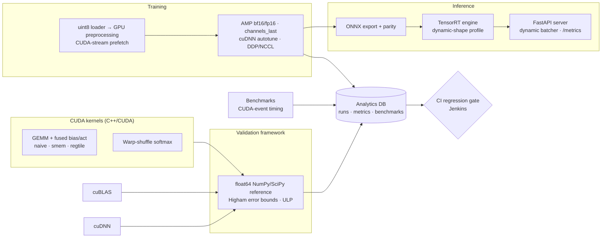

# GPUForge — a GPU-accelerated MLOps platform

An end-to-end, production-style ML Operations stack built around NVIDIA's accelerated-computing toolchain:
**custom CUDA kernels → numerical validation against cuBLAS/cuDNN → mixed-precision multi-GPU training over NCCL →
ONNX/TensorRT real-time inference with dynamic batching → back-end performance analytics with a CI regression gate**,
deployable with Docker, Kubernetes, SLURM, Jenkins and Ansible.



## How it maps to the NVIDIA JD (Machine Learning Operations track, plus Tools Infra / Dev Tools)

| JD requirement | Where it lives |
|---|---|
| GPU computing, accelerated computing, **CUDA** | `gpuforge/kernels/csrc/kernels.cu` — 3 GEMM variants (naive → shared-mem tiling → 64×64 block / 4×4 register tiling) with fused bias+ReLU/GELU epilogue, warp-shuffle softmax |
| **Validation frameworks for DL**, cuBLAS, cuDNN, NumPy, SciPy | `gpuforge/validation/` — validates custom kernels, `torch.matmul` (cuBLAS) and `F.conv2d` (cuDNN) in fp32/TF32/fp16/bf16 against float64 NumPy/SciPy references using *theoretical* error bounds, not magic tolerances |
| **Linear algebra & numerical methods** | Higham forward-error bound `γ_K·(|A||B|)`, ULP distance, implicit-GEMM view of convolution, stable softmax |
| **Data preprocessing** | `gpuforge/data/pipeline.py` — uint8 transfer (4× less PCIe), on-GPU normalise/crop/flip, side-stream prefetcher overlapping H2D with compute |
| **Training acceleration (CUDA, cuDNN, NCCL)** | `gpuforge/train/train.py` — AMP (bf16 / fp16 + GradScaler), TF32, `cudnn.benchmark`, channels_last, `torch.compile`, DDP over NCCL via `torchrun`, NVTX ranges for Nsight |
| **Convolution operations (cuDNN)** | ResNet backbone + cuDNN conv validation incl. strided / 1×1 / 5×5 cases |
| **Real-time inference (TensorRT)** | `gpuforge/export/` (ONNX → TensorRT FP16/INT8 engine, dynamic-batch profile, parity checks) and `gpuforge/serve/` (TensorRT 10 runtime, ONNX Runtime, PyTorch backends behind a dynamic batcher) |
| **Infrastructure for back-end analytics** | `gpuforge/analytics/` — SQLite schema for runs/metrics/benchmarks/validations + robust (median/MAD) regression detection |
| Debugging/perf tuning, application tracing | `gpuforge/profiling/` (torch.profiler → Perfetto trace) + NVTX for `nsys`; CUDA-event timing in `bench/timing.py` |
| Jenkins, Docker, Kubernetes, SLURM, Ansible, Git CI | `infra/jenkins/Jenkinsfile`, `infra/docker/Dockerfile` (NGC base), `infra/k8s/*.yaml` (`nvidia.com/gpu`), `infra/slurm/train_ddp.sbatch` (multi-node torchrun), `infra/ansible/gpu_node.yml`, `.github/workflows/ci.yml` |
| C++, Python, OOP | pybind/Torch C++ extension, typed Python package with pluggable `Backend` classes |

## Quick start

```bash
pip install --no-build-isolation -e ".[dev]"   # compiles the CUDA extension if nvcc is present
make test        # 40 tests (CUDA-kernel tests auto-skip without a GPU)
make validate    # numerical validation report -> reports/validation.json
make train       # or: make train-ddp  (all local GPUs over NCCL)
make export      # ONNX + TensorRT FP16 engine
make bench       # kernel TFLOPS vs cuBLAS, inference latency/throughput per backend
make report      # analytics summary + regression check
make serve BACKEND=tensorrt ARTIFACT=artifacts/model_fp16.plan
```

Try the server:
```bash
python - <<'EOF'
import numpy as np, requests
x = np.random.randn(4, 3, 32, 32).tolist()
print(requests.post("http://localhost:8000/v1/predict", json={"inputs": x, "top_k": 3}).json())
EOF
curl localhost:8000/metrics     # p50/p95/p99 latency, mean batch size
```

## Design notes (good interview material)

**Why three GEMM variants?** Each one isolates one optimisation so the benchmark explains the speed-up rather than just
reporting it. *naive* re-reads A and B from global memory K times per output. *smem* stages 32×32 tiles in shared memory,
cutting global traffic by ~32×. *regtile* has each thread compute a 4×4 output tile from registers, so every shared-memory
load feeds 4 FMAs instead of 1 — raising arithmetic intensity, which is the same idea cuBLAS/CUTLASS take much further
(tensor cores, async copies, double buffering). Compiled for sm_80/sm_90, `ptxas -v` reports 57 registers / 4 KB smem
for *regtile* and **zero spills** for all four kernels.

**Why error bounds instead of `atol=1e-5`?** For an inner product of length K the rounding error grows with K. A fixed
tolerance either rejects a correct K=4096 GEMM or accepts a buggy K=16 one. The suite instead checks every element against
`γ_{K+2}·(|A||B|)` with the unit round-off of the arithmetic actually used (fp32, TF32, fp16, bf16), and reports
`bound_ratio` (how much of the error budget was used). The test suite proves the check is not vacuous: it rejects an
fp16-quality result under an fp32 bound and catches a kernel that drops a single K-slice.

**Why dynamic batching?** At batch 1 a GPU is mostly idle. The batcher waits at most `max_wait_ms` for more requests,
launches one batched inference off the event loop, and scatters results back — a bounded latency cost for a large
throughput gain. `/metrics` exposes the mean batch size so you can tune the trade-off.

**Why median/MAD for regressions?** GPU timings are noisy (clocks, thermal state, co-tenants). A benchmark is flagged
only if it is >5 % worse than the rolling median *and* outside ~3 robust standard deviations of run-to-run noise, compared
only against runs on the same device model.

## Verified so far (in a CPU-only sandbox)

* 24 tests pass, 16 CUDA-only tests skip; `ruff` clean.
* CUDA extension **compiles and links** for sm_80 and sm_90 with CUDA 13 and imports correctly; input guards work.
* Validation suite: 26/26 CPU checks pass (fp32 BLAS / conv / softmax vs float64).
* Training (single process and 2-process DDP over Gloo) runs and checkpoints; ONNX export parity
  max |Δ| ≈ 1e-7 with 100 % top-1 agreement; server, batcher and analytics gate exercised end-to-end.

**Not yet measured:** anything that needs a GPU — kernel correctness on device, TFLOPS vs cuBLAS, TensorRT latency.
Run `make test validate bench` on a GPU (a free Colab/Kaggle T4 works) and paste the tables below.

## Results (fill in after running on a GPU)

| Kernel (FP32, 4096³) | TFLOPS | % of cuBLAS |
|---|---|---|
| gpuforge.naive | | |
| gpuforge.smem | | |
| gpuforge.regtile | | |
| cuBLAS (FP32) | | 100 |
| cuBLAS (TF32) | | |

| Backend | batch 1 p50 (ms) | batch 64 img/s |
|---|---|---|
| PyTorch FP32 | | |
| PyTorch FP16 | | |
| ONNX Runtime (CUDA EP) | | |
| TensorRT FP16 | | |

## Layout

```
gpuforge/
  kernels/      CUDA C++ kernels + PyTorch binding + Python fallback
  validation/   error-bound numerics + validation suite (CI gate)
  data/         uint8 loader, GPU preprocessing, CUDA-stream prefetcher
  models/       ResNet backbone
  train/        AMP / DDP / NCCL training loop
  export/       ONNX export, TensorRT engine builder
  serve/        backends (PyTorch / ONNX Runtime / TensorRT), dynamic batcher, FastAPI app
  bench/        CUDA-event timing, kernel & inference benchmarks
  analytics/    SQLite store, regression detection, CLI reports
  profiling/    torch.profiler + NVTX
infra/          Docker, Kubernetes, SLURM, Jenkins, Ansible
configs/        training config
tests/          pytest suite
```
